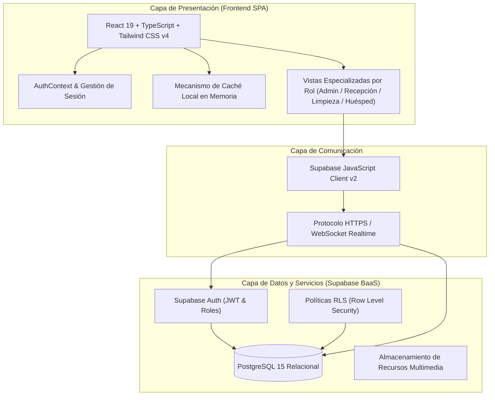
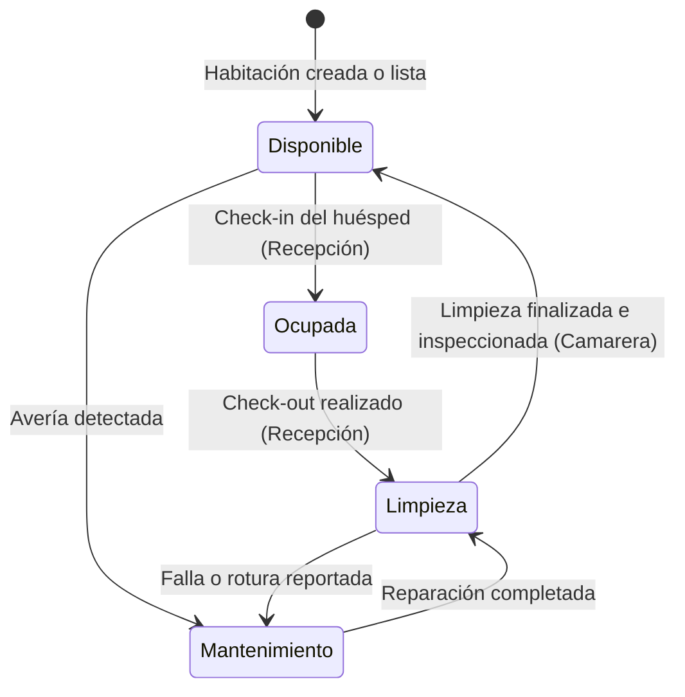
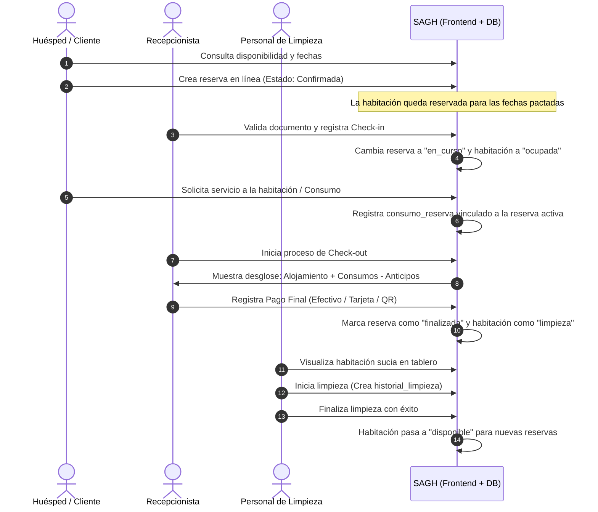
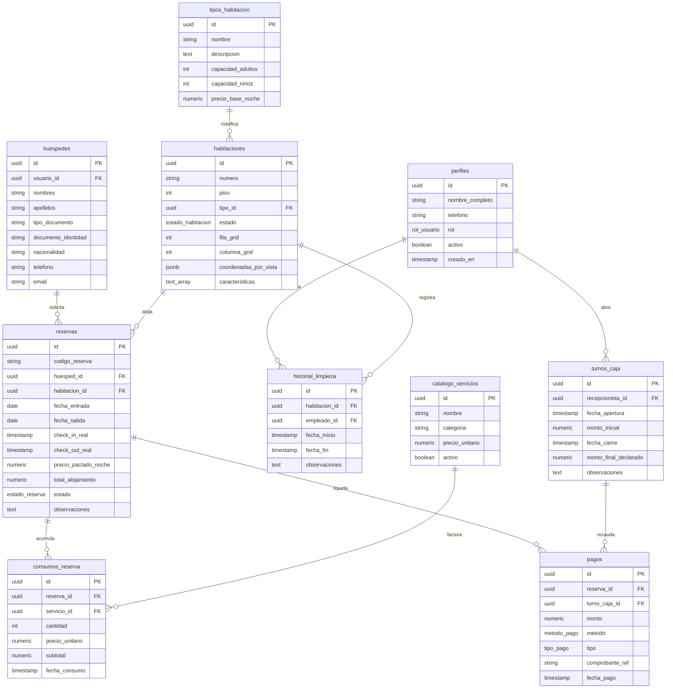

# 🏨 Gran Hotel Illimani ★★★★★
## Sistema de Administración y Gestión Empresarial Hotelera (SAGH)

[](https://react.dev/)
[](https://www.typescriptlang.org/)
[](https://vitejs.dev/)
[](https://tailwindcss.com/)
[](https://supabase.com/)
[](LICENSE)

---

## 📑 Tabla de Contenidos
1. [Introducción y Resumen Ejecutivo](#-introducción-y-resumen-ejecutivo)
2. [Objetivos del Proyecto](#-objetivos-del-proyecto)
3. [Arquitectura del Sistema](#-arquitectura-del-sistema)
4. [Diagramas de Flujo y Estados](#-diagramas-de-flujo-y-estados)
5. [Módulos del Sistema en Detalle](#-módulos-del-sistema-en-detalle)
   - [5.1 Portal del Huésped y Fachada Interactiva](#51-portal-del-huésped-y-fachada-interactiva)
   - [5.2 Módulo de Recepción (Front Desk & Caja)](#52-módulo-de-recepción-front-desk--caja)
   - [5.3 Módulo de Limpieza y Gobernanta (Housekeeping)](#53-módulo-de-limpieza-y-gobernanta-housekeeping)
   - [5.4 Módulo de Administración y Gerencia General](#54-módulo-de-administración-y-gerencia-general)
6. [Diseño de Base de Datos y Modelo Entidad-Relación](#-diseño-de-base-de-datos-y-modelo-entidad-relación)
7. [Seguridad y Control de Acceso (RBAC & RLS)](#-seguridad-y-control-de-acceso-rbac--rls)
8. [Stack Tecnológico y Dependencias](#-stack-tecnológico-y-dependencias)
9. [Estructura del Proyecto](#-estructura-del-proyecto)
10. [Instalación y Configuración Local](#-instalación-y-configuración-local)
11. [Cuentas y Credenciales de Prueba](#-cuentas-y-credenciales-de-prueba)
12. [Scripts y Comandos del Proyecto](#-scripts-y-comandos-del-proyecto)
13. [Autores y Reconocimientos Académicos](#-autores-y-reconocimientos-académicos)

---

## 🌟 Introducción y Resumen Ejecutivo

El **Sistema de Administración y Gestión Hotelera (SAGH)** del **Gran Hotel Illimani ★★★★★** es una solución informática integral diseñada para modernizar, automatizar y centralizar los flujos operativos de la industria de la hospitalidad de alta gama.

El sistema unifica en una única plataforma web reactiva y en tiempo real las cuatro áreas críticas de un establecimiento cinco estrellas:
1. **La experiencia del huésped:** Desde el descubrimiento interactivo y visual del hotel hasta la reserva digital, solicitud de pedidos a la habitación (*Room Service*) y auto-consulta de consumos.
2. **Recepción y Caja (*Front Desk*):** Control visual del rack de habitaciones, gestión de check-in / check-out, asignación ágil de llaves y turnos de caja con control de flujo de efectivo, tarjeta y QR.
3. **Limpieza y Mantenimiento (*Housekeeping*):** Monitoreo del estado higiénico y operativo de las habitaciones, trazabilidad de desinfección mediante historial de intervenciones y reporte de averías.
4. **Gerencia y Auditoría (*Management*):** Analítica de ocupación, métricas financieras de rendimiento hotelero, administración del catálogo tarifario y gestión del personal.

Desarrollado como proyecto para la asignatura de **Taller de Sistemas II**.

---

## 🎯 Objetivos del Proyecto

### Objetivo General
Desarrollar e implementar un sistema web integral de gestión hotelera que optimice la asignación de recursos, reduzca los tiempos de espera en recepción y brinde una experiencia interactiva y transparente a huéspedes y personal del Gran Hotel Illimani mediante tecnologías web modernas y arquitecturas reactivas en la nube.

### Objetivos Específicos
* **Digitalizar el ciclo de vida de la habitación:** Controlar en tiempo real los cuatro estados operativos (*Disponible*, *Ocupada*, *Limpieza* y *Mantenimiento*), eliminando sobreventas o asignaciones erróneas.
* **Proveer una Fachada Hotelera Fotogramétrica:** Implementar un componente gráfico que permita a los clientes visualizar la distribución espacial real del edificio en distintas perspectivas (*Frontal*, *Lateral Izquierda*, *Lateral Derecha*) mediante puntos de interés (*hotspots*) calculados dinámicamente.
* **Centralizar los consumos y facturación:** Registrar consumos adicionales (minibar, restaurante, lavandería, spa) vinculados a la reserva del huésped y calcular automáticamente el balance final antes del check-out.
* **Asegurar la trazabilidad financiera:** Controlar la apertura y cierre de turnos de caja de recepción con registro de métodos de pago (efectivo, tarjeta, transferencia bancaria y código QR).
* **Garantizar la seguridad de la información:** Proteger los datos sensibles mediante políticas de seguridad por fila (*Row Level Security - RLS*) en PostgreSQL y autenticación basada en roles (*RBAC*).

---

## 🏗️ Arquitectura del Sistema

El sistema implementa una arquitectura desacoplada basada en el patrón **BaaS (Backend as a Service)** combinada con una **Single Page Application (SPA)** de alto rendimiento:



---

## 🔄 Diagramas de Flujo y Estados

### 1. Ciclo de Vida de una Habitación



### 2. Flujo Completo de Reserva y Liquidación



---

## 📦 Módulos del Sistema en Detalle

### 5.1 Portal del Huésped y Fachada Interactiva
El portal para clientes ofrece una experiencia inmersiva que se adapta automáticamente a la situación del huésped:

* **Modo Sin Reserva Activa (`SinReservaView`):**
  * Buscador interactivo por rango de fechas (entrada y salida), cantidad de adultos y niños.
  * Selector visual de categorías: *Simple Estándar*, *Doble Confort*, *Suite Junior*, *Suite Nupcial*, *Suite Presidencial Illimani*.
  * **Fachada Fotogramétrica 3D/2D (`FachadaHotelInteractiva`):**
    * Exploración panorámica mediante pestañas de perspectiva (*Fachada Frontal*, *Lateral Izquierda*, *Lateral Derecha*).
    * Cálculo dinámico de recuadros interactivos (*hotspots*) sobre la fotografía real del hotel basados en datos JSONB de la habitación (`x`, `y`, `ancho`, `alto`).
    * Filtro instantáneo por nivel de piso (Pisos 1 al 10 o vista panorámica general).
    * Detección visual de amenidades externas: Terraza panorámica, piscina en azotea, lobby y áreas de acceso.
* **Modo Reserva Confirmada (`ReservaConfirmadaView`):**
  * Presentación del código alfanumérico único de reserva (ej. `RES-2026-X89K`).
  * Desglose del tipo de habitación asignada, fechas pactadas y políticas de check-in.
  * Cuenta regresiva y detalles para la recepción del huésped.
* **Modo Estadía en Curso (`EnHotelView`):**
  * Interfaz de bienvenida con el número de habitación y piso.
  * Catálogo de pedidos al cuarto (*Room Service*): Gastronomía, bebidas, lavandería express y reservas de spa.
  * Registro y visor de consumos acumulados en tiempo real con detalle de subtotal y cargos a la habitación.
  * Botón de solicitud de asistencia inmediata al personal de recepción.

---

### 5.2 Módulo de Recepción (Front Desk & Caja)
Diseñado para maximizar la velocidad de atención y minimizar colas en el lobby:

* **Front-Desk Operativo:**
  * Búsqueda inteligente por nombre, apellido, código de reserva o documento de identidad.
  * Registro de Check-in con verificación de documentos de identidad extranjeros o nacionales.
  * Proceso de Check-out con resumen interactivo de cuenta corriente:
    * Total pactado de alojamiento.
    * Detalle pormenorizado de consumos y servicios adicionales.
    * Pagos o anticipos realizados previamente.
    * Saldo pendiente de pago.
* **Rack de Habitaciones de Recepción:**
  * Cuícula visual tipo cuadrícula de todas las habitaciones organizadas por piso.
  * Identificación inmediata mediante código de colores estándar internacional:
    * 🟢 **Verde:** Disponible.
    * 🔴 **Rojo:** Ocupada (muestra nombre del huésped y fecha de salida).
    * 🟡 **Amarillo / Ámbar:** En proceso de Limpieza.
    * ⚪ **Gris / Naranja:** Mantenimiento / Avería técnica.
  * Menú de acciones rápidas al hacer clic sobre una habitación (cambio de estado forzado, ver detalle de la reserva actual).
* **Gestión de Consumos Rápidos:**
  * Posibilidad de cargar consumos de servicios directamente a cualquier habitación ocupada sin salir de recepción.
* **Turnos de Caja y Cobranza:**
  * Control estricto de turnos: Apertura de turno con monto inicial en efectivo declarado.
  * Registro de pagos vinculados al turno del recepcionista con soporte multimoneda y métodos de pago:
    * 💵 Efectivo.
    * 💳 Tarjeta de Crédito / Débito.
    * 🏦 Transferencia bancaria.
    * 📱 Código QR de cobro instantáneo.
  * Arqueo y cierre de turno: Validación entre el total cobrado por el sistema y el monto físico final declarado.

---

### 5.3 Módulo de Limpieza y Gobernanta (Housekeeping)
Herramienta optimizada para dispositivos móviles y tabletas utilizada por el personal de limpieza:

* **Tablero de Limpieza en Vivo:**
  * Listado filtrable de habitaciones por piso o por urgencia de desinfección.
  * Notificación visual de habitaciones desocupadas recién entregadas por recepción.
* **Flujo de Trazabilidad:**
  * Botón **"Iniciar Limpieza"**: Cambia el estado a *Limpieza* y registra automáticamente la hora exacta y el ID de la camarera en la tabla `historial_limpieza`.
  * Botón **"Finalizar y Habilitar"**: Registra la hora de finalización, calcula el tiempo empleado y devuelve la habitación a estado *Disponible* en recepción inmediatamente.
* **Reporte de Fallas y Averías:**
  * Modal para notificar roturas, problemas de fontanería, electricidad o cerraduras electrónicas.
  * La habitación se traslada a estado *Mantenimiento* de forma preventiva, impidiendo que recepción la asigne a un nuevo huésped hasta su resolución.

---

### 5.4 Módulo de Administración y Gerencia General
Panel de mando para el director del hotel y administradores de sistemas:

* **Métricas y Analítica Hotelera (`MetricasHotelAdmin`):**
  * Tasa de ocupación porcentual en tiempo real.
  * Distribución de inventario de habitaciones.
  * Ingresos totales generados (alojamiento versus consumos extras).
  * Monitoreo de rotación de habitaciones.
* **Rack Maestro de Habitaciones (`RackHabitacionesAdmin`):**
  * Supervisión global de la estructura edilicia y configuración de coordenadas de fachada.
* **Gestión de Personal (`GestionTrabajadores`):**
  * Alta de nuevos trabajadores asignando roles de sistema (`admin`, `recepcionista`, `limpieza`, `huesped`).
  * Activación o desactivación de accesos laborales.
* **Gestión de Huéspedes (`GestionHuespedes`):**
  * Directorio centralizado de clientes con información de pasaporte, nacionalidad, teléfono y correo electrónico.
* **Catálogo de Servicios (`CatalogoServiciosAdmin`):**
  * Creación y edición de servicios con nombre, categoría (Gastronomía, Minibar, Spa, Lavandería, Transporte) y precio unitario en moneda local.
* **Modo Supervisión Transversal:**
  * Capacidad exclusiva del rol Administrador para cambiar entre las vistas de Recepción, Limpieza o Huésped con fines de soporte y auditoría sin cerrar sesión.

---

## 🗄️ Diseño de Base de Datos y Modelo Entidad-Relación

El backend relacional está implementado en **PostgreSQL 15** mediante Supabase. A continuación se detalla el diagrama lógico del sistema:



### Tipos Enumerados (ENUMs) Definidos
* `rol_usuario`: `'admin'`, `'recepcionista'`, `'limpieza'`, `'huesped'`.
* `estado_habitacion`: `'disponible'`, `'ocupada'`, `'limpieza'`, `'mantenimiento'`.
* `estado_reserva`: `'pendiente'`, `'confirmada'`, `'en_curso'`, `'finalizada'`, `'cancelada'`.
* `metodo_pago`: `'efectivo'`, `'tarjeta'`, `'transferencia'`, `'qr'`.
* `tipo_pago`: `'anticipo'`, `'pago_final'`, `'garantia'`.

---

## 🔒 Seguridad y Control de Acceso (RBAC & RLS)

La seguridad se ejecuta en dos capas complementarias:

### 1. Control de Acceso en Frontend (React Context & Enrutador)
* El componente `AuthContext` valida el token JWT generado por Supabase y consulta el rol oficial registrado en la tabla `perfiles`.
* Si un usuario con rol `huesped` intenta forzar el acceso a paneles administrativos, la interfaz lo redirige obligatoriamente a su portal correspondiente.
* Solo las cuentas con rol `admin` tienen acceso al botón de cambio de vista operativa de supervisión.

### 2. Políticas de Seguridad a Nivel de Fila (Row Level Security - RLS en PostgreSQL)
Incluso si un usuario malintencionado intenta consultar la base de datos directamente mediante peticiones HTTP a la API REST de Supabase, las políticas RLS restringen estrictamente las operaciones:
* **Catálogos públicos:** Lectura permitida para cualquier usuario autenticado o anónimo sobre tipos de habitación y catálogo de servicios.
* **Reservas:** Los huéspedes únicamente pueden consultar y modificar reservas que les pertenezcan (`huesped_id` vinculado a su `auth.uid()`).
* **Personal y Roles:** Únicamente los usuarios con función `es_admin() = true` pueden insertar o modificar registros en la tabla de `perfiles` y `turnos_caja`.
* **Historial de Limpieza:** Restringido a usuarios con roles operativos (`limpieza`, `recepcionista`, `admin`).

---

## 💻 Stack Tecnológico y Dependencias

| Tecnología | Versión | Propósito en el Proyecto |
| :--- | :--- | :--- |
| **React** | `^19.3.1` | Biblioteca base para la construcción de interfaces de usuario declarativas y reactivas. |
| **TypeScript** | `~6.0.3` | Tipado estático estricto para garantizar solidez y prevenir errores en tiempo de compilación. |
| **Vite** | `^8.3.4` | Empaquetador y entorno de desarrollo de ultra alta velocidad con soporte HMR. |
| **Tailwind CSS** | `^4.3.3` | Framework de diseño utilitario para estilos modernos, responsivos y modo oscuro sofisticado. |
| **@supabase/supabase-js** | `^2.118.0` | SDK oficial para la interacción con la base de datos PostgreSQL, autenticación y sockets en tiempo real. |
| **Lucide React** | `^1.61.0` | Conjunto completo de iconografía vectorial limpia y estilizada. |
| **React Router Dom** | `^7.18.4` | Gestión de rutas dinámicas y control de navegación SPA. |
| **Clsx & Tailwind-Merge**| `^2.1.1` | Combinación condicional de clases CSS sin colisiones de precedencia. |

---

## 📂 Estructura del Proyecto

```text
Sistema-Gestion-Hotelera/
├── public/                               # Archivos estáticos servidos directamente
│   ├── fachada_frontal.jpg              # Fotografía de fachada frontal del Gran Hotel Illimani
│   ├── fachada_lateral_der.jpg          # Fotografía de fachada lateral derecha
│   ├── fachada_lateral_izq.jpg          # Fotografía de fachada lateral izquierda
│   ├── Fondo.jpg                        # Fondo escénico de alta resolución para login y autenticación
│   ├── favicon.svg                      # Isotipo oficial del sistema
│   └── ...                              # Imágenes de habitaciones y amenidades
├── src/
│   ├── components/
│   │   ├── admin/                       # Componentes del Director / Administrador General
│   │   │   ├── CatalogoServiciosAdmin.tsx # Gestión CRUD de servicios, amenidades y tarifas
│   │   │   ├── DashboardAdmin.tsx       # Tablero maestro de administración
│   │   │   ├── GestionHuespedes.tsx     # Directorio central de clientes y pasaportes
│   │   │   ├── GestionTrabajadores.tsx  # Asignación de roles y personal del hotel
│   │   │   ├── MetricasHotelAdmin.tsx   # Gráficos y analítica de ocupación e ingresos
│   │   │   └── RackHabitacionesAdmin.tsx # Vista estructural y espacial de habitaciones
│   │   ├── auth/                        # Componentes de autenticación y seguridad
│   │   │   ├── Login.tsx                # Formulario de inicio de sesión seguro
│   │   │   ├── RegistroHuesped.tsx      # Registro internacional para nuevos huéspedes
│   │   │   └── SelectorPais.tsx         # Selector de nacionalidad con banderas y códigos dial
│   │   ├── common/                      # Componentes gráficos transversales
│   │   │   └── LogoHotel.tsx            # Isotipo y logotipo estilizado cinco estrellas
│   │   ├── dashboard/                   # Experiencia del Huésped
│   │   │   ├── DashboardHuesped.tsx     # Controlador de estado de la experiencia del cliente
│   │   │   ├── EnHotelView.tsx          # Pantalla de huésped hospedado (consumos y room service)
│   │   │   ├── FachadaHotelInteractiva.tsx # Módulo fotogramétrico con coordenadas hotspot
│   │   │   ├── HuespedNavbar.tsx        # Barra de navegación del cliente
│   │   │   ├── PerfilUsuario.tsx        # Configuración de cuenta y datos personales
│   │   │   ├── ReservaConfirmadaView.tsx # Ficha y credencial de reserva confirmada
│   │   │   └── SinReservaView.tsx       # Catálogo de reservas y selección de fechas
│   │   ├── diagnostico/                 # Herramientas de comprobación
│   │   │   └── StatusCheck.tsx          # Validador de conectividad con Supabase
│   │   ├── landing/                     # Presentación institucional
│   │   │   └── LandingPage.tsx          # Portal cinco estrellas con amenidades y contacto
│   │   ├── limpieza/                    # Módulo de Housekeeping
│   │   │   └── DashboardLimpieza.tsx    # Tablero de habitaciones, registro de aseo y averías
│   │   └── recepcion/                   # Módulo de Recepción y Front Desk
│   │       └── DashboardRecepcion.tsx   # Check-in, check-out, rack operativo y arqueo de caja
│   ├── context/
│   │   └── AuthContext.tsx              # Contexto de autenticación, control de turno y roles
│   ├── data/
│   │   ├── hotelData.ts                 # Constantes de fachada, funciones de hotspots y catálogo
│   │   └── paises.ts                    # Listado internacional de países y códigos telefónicos
│   ├── lib/
│   │   ├── cache.ts                     # Caché optimizada para almacenamiento en memoria/local
│   │   └── supabase.ts                  # Inicialización y configuración del cliente Supabase
│   ├── services/
│   │   └── trabajadoresService.ts       # Servicios para la gestión de empleados y cuentas
│   ├── types/
│   │   └── database.ts                  # Tipos TypeScript autogenerados y adaptados de la BD
│   ├── App.tsx                          # Enrutamiento condicional y renderizado por rol
│   ├── index.css                        # Configuración de Tailwind CSS y variables visuales
│   └── main.tsx                         # Punto de arranque de la aplicación React
├── supabase/
│   └── seed_hotel_illimani.sql          # Migración completa: esquemas, tablas, RLS y seed data
├── .env.example                         # Plantilla de variables de entorno requeridas
├── index.html                           # Documento HTML base
├── package.json                         # Dependencias y scripts del proyecto
├── tsconfig.json                        # Configuración del compilador TypeScript
└── vite.config.ts                       # Configuración de compilación y plugins de Vite
```

---

## 🚀 Instalación y Configuración Local

Sigue estos pasos para clonar, configurar y ejecutar el proyecto en tu entorno local:

### 1. Clonar el Repositorio
```bash
# Repositorio oficial del grupo:
git clone https://github.com/TALLER-DE-SISTEMAS-II/Sistema-Gestion-Hotelera-Gran-Hotel-Illimani.git

# Ingresar al directorio del proyecto:
cd Sistema-Gestion-Hotelera-Gran-Hotel-Illimani
```

### 2. Instalar Dependencias del Proyecto
Asegúrate de tener instalado [Node.js](https://nodejs.org/) (versión 18 o superior recomendada):
```bash
npm install
```

### 3. Configurar Variables de Entorno
Copia el archivo de plantilla `.env.example` para generar tu `.env`:
```bash
cp .env.example .env
```
Edita el archivo `.env` resultante e introduce la URL y clave pública de tu proyecto Supabase:
```env
VITE_SUPABASE_URL=https://tu-proyecto.supabase.co
VITE_SUPABASE_ANON_KEY=tu-clave-anonima-publica
```

### 4. Ejecutar el Script de Base de Datos en Supabase
1. Ingresa a tu panel en [Supabase](https://supabase.com/).
2. Dirígete a la sección **SQL Editor**.
3. Abre el archivo `supabase/seed_hotel_illimani.sql` ubicado en este proyecto, copia todo su contenido y ejecútalo.
4. Esto creará automáticamente todas las tablas, funciones almacenadas, políticas RLS y los datos iniciales de habitaciones, tipos de cuartos y catálogo de servicios del Gran Hotel Illimani.

### 5. Iniciar la Aplicación en Modo Desarrollo
```bash
npm run dev
```
Abre tu navegador en:
```text
http://localhost:5173
```

---

## 🔑 Cuentas y Credenciales de Prueba

Para facilitar la evaluación y demostración de los cuatro roles de usuario en defensas académicas o revisiones, se han configurado los siguientes perfiles de acceso:

| Rol | Correo Electrónico | Contraseña | Panel / Vista Principal |
| :--- | :--- | :--- | :--- |
| **👑 Administrador General** | `admin@hotelillimani.bo` | `Admin123*` | Métricas, Personal, Catálogo, Rack y Supervisión Total |
| **🛎️ Recepcionista Principal** | `recepcion@hotelillimani.bo` | `Recepcion123*` | Front-Desk, Check-In, Check-Out, Consumos y Turno de Caja |
| **🧹 Personal de Limpieza** | `limpieza@hotelillimani.bo` | `Limpieza123*` | Tablero de Limpieza, Control de Tiempos y Reporte de Averías |
| **🧳 Huésped de Demostración** | `huesped@gmail.com` | `Huesped123*` | Portal del Huésped, Fachada Interactiva y Servicios |

> [!NOTE]
> También puedes registrar una nueva cuenta de huésped en cualquier momento desde el botón **"Registrarse"** en la página de inicio o en la pantalla de acceso.

---

## ⚡ Scripts y Comandos del Proyecto

En el archivo `package.json` se encuentran los comandos de mantenimiento y desarrollo:

* `npm run dev`: Inicia el servidor de desarrollo local con Vite y soporte para recarga rápida de módulos (*HMR*).
* `npm run build`: Compila el código en TypeScript comprobando tipos estrictos (`tsc -b`) y genera los archivos optimizados para producción en la carpeta `dist/`.
* `npm run preview`: Levanta un servidor web local para probar el paquete de producción generado por `npm run build`.
* `npm run lint`: Ejecuta el analizador de código estático ESLint para asegurar el cumplimiento de buenas prácticas y estilo.

---

## 🎓 Autores y Reconocimientos Académicos

* **Desarrollador Principal:** Enrique Villazante ([@EnriqueVillazante](https://github.com/EnriqueVillazante))
* **Asignatura:** Taller de Sistemas II
* **Proyecto:** Sistema de Administración y Gestión Empresarial Hotelera (SAGH)
* **Institución:** Carrera de Ingeniería de Sistemas / Informática

---

<p align="center">
  <b>Gran Hotel Illimani ★★★★★</b><br>
  <i>Elegancia, Excelencia y Tecnología de Vanguardia en Hospitalidad</i>
</p>
